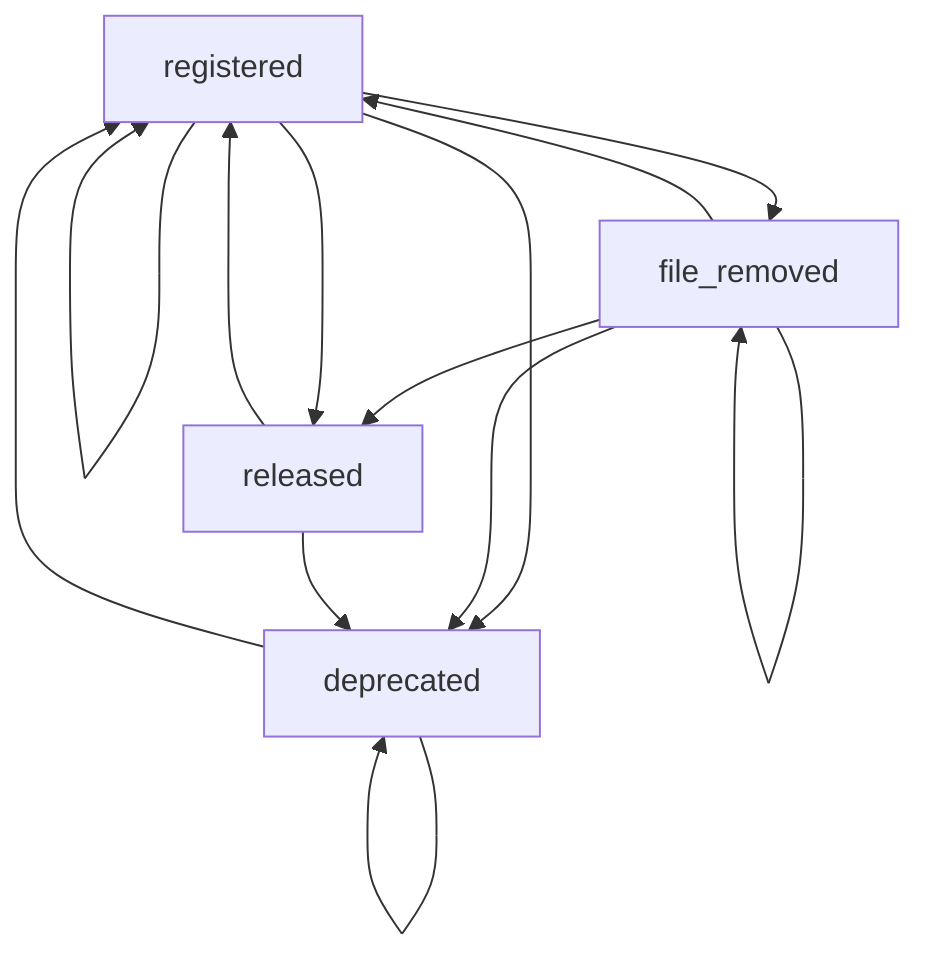
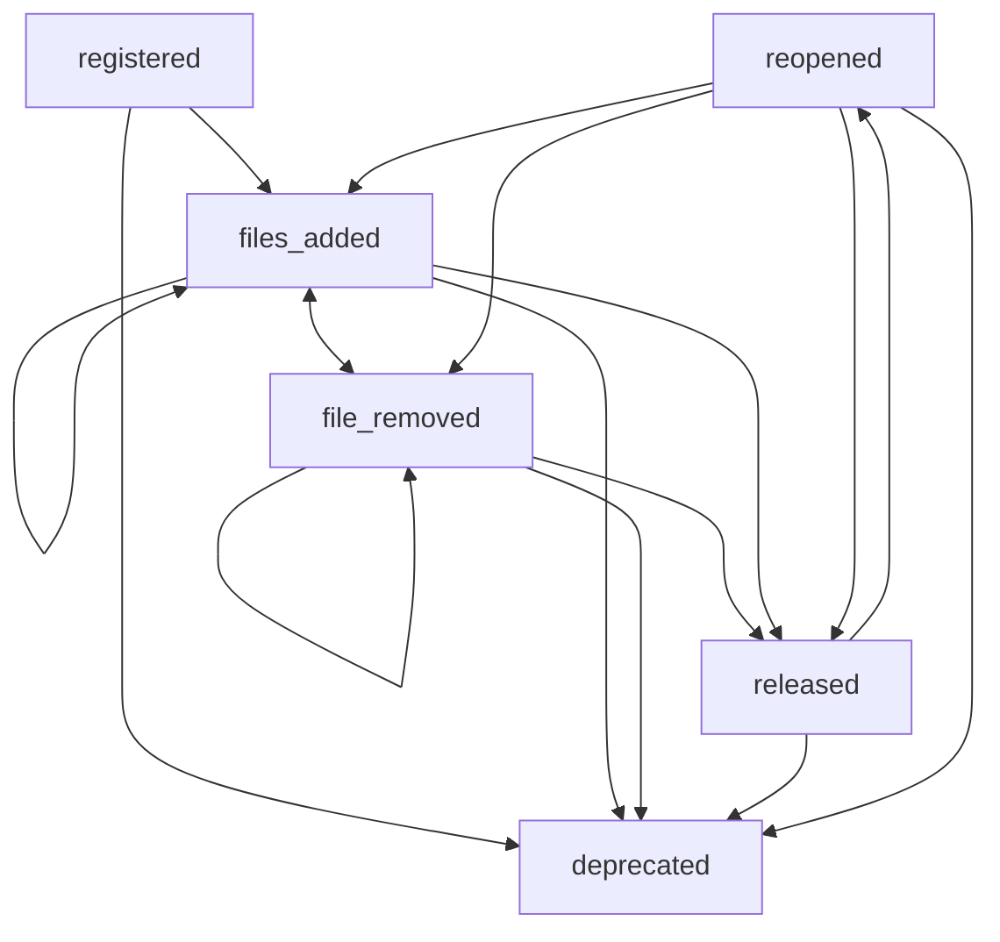
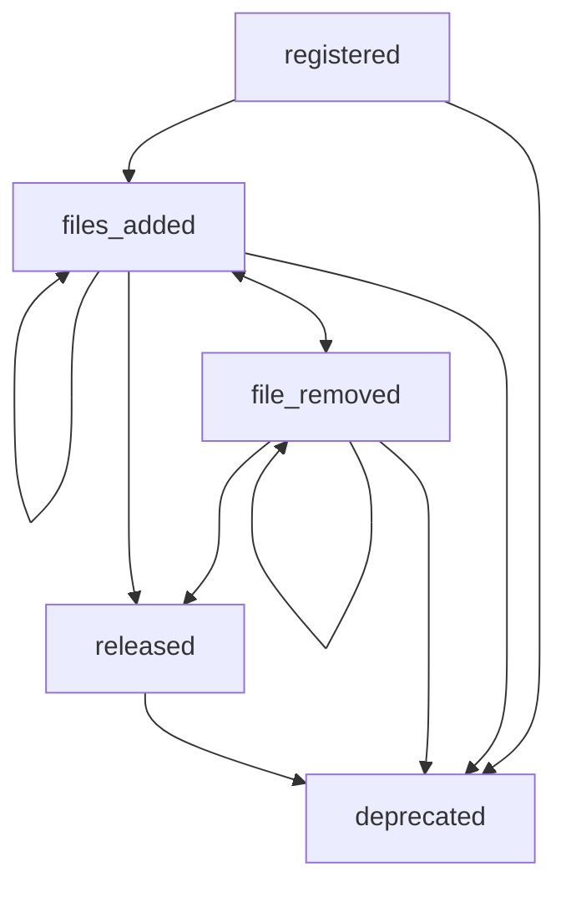

# Dataset Lifecycle

## Context and Problem Statement

Currently (sda v4.1.0), datasets can have 4 possible events: `registered`, `file_removed`, `released`, and `deprecated`,
but there is little to no enforcement of how a dataset moves through these events, what actions can be done at what state, etc.

For example in the current download (and download-v2) a dataset can be downloaded no matter what the latest event is.
This is tracked by [#2591](https://github.com/neicnordic/sensitive-data-archive/issues/2591)

Event descriptions:

* `registered`
  * The creation/registration of a dataset accession (First entry)
  * The addition of file associations to a dataset
* `file_removed`
  * The removal of a file association from a dataset
* `released`
  * The release of a dataset
* `deprecated`
  * The deprecation of a dataset

Current event flow:

The aim of this ADR is to propose, describe, and clarify a dataset lifecycle that is to be adopted.

## Decision Outcome

Chosen lifecycle to be adopted: [Dataset lifecycle with modifications allowed](#dataset-lifecycle-with-modifications-allowed).

As based on the current usage of the sensitive data archive being able to modify a dataset appears to be desired.

But allow the [Dataset lifecycle no modifications allowed after release](#dataset-lifecycle-no-modifications-allowed-after-release)
through deployment options to not support the `reopened` event, meaning the only possible event after `released` is `deprecated`.

### Common rules for both options

A dataset can only be downloaded while its latest event is `released`.
Any other event indicates that the current state of the dataset is not ready for consumption.

When a dataset is deprecated, no further action can be done on the dataset.
Files originating from the submission of the dataset are **not** deprecated/deleted as part of the dataset deprecation action (currently there is no "file deletion/deprecation" functionality).

How file deprecation/deletion is to be handled is to be decided by [File lifecycle ADR](#file-lifecycle-adr).

No matter what the last event is, deprecation is always allowed (except when its already deprecated).
This is to avoid punishing mistakes where resolution otherwise would be transition through an intermediary status to reach the final desired event of `deprecated`.

A dataset with no associated files should not be able to be `released`. This will have to be enforced when the `released` event is processed.

* Good, because there is a clear indication of when a dataset is ready for consumption/downloading.
* Bad, because dataset deprecation can not be reverted if done accidentally.
* Good, because intentional dataset deprecation is final.
* Neutral, because the files originating from a dataset still need to be dealt with when the dataset is deprecated.

### Dataset lifecycle with modifications allowed

Introduce new events, and update the current usage of existing ones:

Event descriptions:

* `registered`
  * The creation/registration of a dataset accession.
* `files_added`
  * The addition of one or more file associations to a dataset (One event per request).
* `file_removed`
  * The removal of a file association from a dataset.
* `released`
  * The release of a dataset and for it to be available for download.
* `reopened`
  * The re-opening of a dataset for modifications. Makes the dataset unavailable for download.
* `deprecated`
  * The deprecation of a dataset.

The "normal" path for a dataset would be `registered` -> X `files_added` -> `released` -> `deprecated`.
Where the `released` event marks the dataset as complete, and no more modifications are expected.

A dedicated `reopened` event is preferred over allowing `files_added` / `file_removed` directly after `released` for
dataset modifications, for the following reasons:

**Intent is explicit and recorded.** `reopened` states that a modification is about to happen, and its details can record
when and why (for example, the reason the dataset is being modified).
Without it, the log only shows that files changed, not whether that was intentional.

**Accidental changes cannot silently unrelease a dataset.**
If file additions / removals were allowed directly after `released`,
a stale or mistaken request would take a live dataset offline as a side effect. For example:

1. User requests to release a dataset; the release message is queued.
2. User (or another client) requests file addition; the file addition message is queued.
3. The release message is processed, and the dataset is `released`.
4. The file addition message is processed, and the dataset is no longer `released`.

The dataset has silently left the released state, and nothing distinguishes this accident from an intentional
modification. With `reopened`, step 4 is rejected, because a file addition is not valid after `released` unless the
dataset has first been explicitly reopened.

**Modifications after release can be switched off in one place.**
A deployment that does not want modifications after release can disable the single `reopened` action.
Without it, the same rule would have to be checked inside both the file addition and file removal actions.

* Good, because "versioning" of a dataset could be possible by the number of `released` events.
  * And to get a primitive changelog with the difference in the set of files between each version.
* Bad, because the lifecycle is still relatively complex with generally multiple events allowed based on the last event.

### Dataset lifecycle no modifications allowed after release

Mainly keep existing lifecycle with the addition of the separation of the `registered` and `files_added` events, and only allowing the `deprecated` event after `released`.
This means that once a dataset has been released, it can not be modified beyond deprecation.

Event descriptions:

* `registered`
  * The creation/registration of a dataset accession.
* `files_added`
  * The addition of one or more file associations to a dataset (One event per request).
* `file_removed`
  * The removal of a file association from a dataset.
* `released`
  * The release of a dataset and for it to be available for download.
* `deprecated`
  * The deprecation of a dataset.

The `file_removed` event is in practice most likely never going to be used in this lifecycle as it requires a mistake during
the dataset creation. But it is kept as the functionality already exists and for the few rare cases where it would be beneficial.

* Good, because the lifecycle is relatively straightforward with a simple flow.
* Bad, because a new dataset with a different accession id needs to be created if a file is to be removed from a dataset
  * Which in practice means that it is a whole new dataset, and any existing visas, etc are void.

## More Information

### Dataset events should be processed sequentially

To avoid potential issues due to race conditions, etc, the dataset events relating to the same dataset
(by the dataset accession id) should be processed sequentially in the order they were requested.

### Why dataset deprecation does not deprecate the files

In the proposed lifecycles the deprecation of a dataset does not deprecate/delete files originating from those datasets.
One reasoning for this is that there is currently no reliable way of identifying which dataset a file originated from.
In practice, it could be derived from the first dataset a file was added to, but that is not necessarily definitive in theory.  

Another is that it adds complexity when a file is in multiple datasets. For example if a file is in multiple datasets
and the origin dataset is deprecated, then should that file be removed from all other datasets? And if so, those other
datasets need to be updated:

* Which in the case of [Dataset lifecycle no modifications allowed after release](#dataset-lifecycle-no-modifications-allowed-after-release)
  * Is not possible without the generation of a new dataset for each affected dataset, which would also void any existing visas (as new accession ids are generated).
* And in the case of [Dataset lifecycle with modifications allowed](#dataset-lifecycle-with-modifications-allowed)
  * Would require a re-opening of each dataset, file removals, then a release.

And there is also a possibility of a file within a dataset being included in some metadata files, which would also need
modifications such that a dataset's metadata files do not contain information about removed files. Meaning in addition
to just removing the deprecated / deleted files, new metadata files would need to be ingested, accessioned, and then
replace the old metadata files.

### Data migration

For existing datasets there needs to be a data migration to update the dataset_event_log for datasets which have multiple
`registered` events which detail the addition of files, and for the existing event logs to adhere to the new lifecycle.

### File Lifecycle ADR

As a follow-up to this ADR, there should be a File Lifecycle ADR that details the file lifecycle, including how the file
deprecation/deletion relates to datasets.

## Outstanding issues / Out of scope

Messages in the queue which have not yet been actioned could allow callers to successfully request actions which will later
be rejected without any feedback.

For example given an existing dataset:

1. User requests to release dataset successfully
   1. Dataset release message is put in queue
2. User requests to remove a file from dataset
   1. File removal message is put in queue
3. Dataset release message is consumed and actioned
4. File removal message is consumed and rejected
