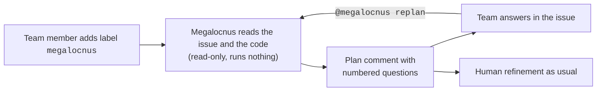

# Let a Claude bot ("Megalocnus") refine issues

## Context and Problem Statement

Many of our issues reach refinement half-specified, and the first part of every refinement is finding out what is unclear.
Several of us already use Claude Code locally for that kind of work.
This RFC proposes a four-week pilot where a Claude bot reads an issue and the code it touches, and posts a plan with clarifying questions *before* the team refines it.
The bot writes no code; whoever picks up the issue implements it as usual.

## How the pilot works

* **Trigger:** a team member with write access adds the `megalocnus` label or comments `@megalocnus replan`. Editing the issue does not trigger a new plan. During the pilot the bot does not comment on new issues by itself, so nobody gets notifications they did not ask for.
* **Output, in two steps:** while something is unclear, the comment has only a short understanding (with a proposed user story if a feature lacks one), at most five numbered questions and overlapping open issues, in under 150 words. Once the team has answered and comments `@megalocnus replan`, it gives a plan following our issue templates: acceptance criteria as checkboxes ending with "Tests verifying the changes are added", the files and steps, and a size (small/medium/big; priority stays with the team). Each run posts "Plan v2", "Plan v3" and so on.
* **Feedback:** each plan asks for a 👍 or 👎 reaction, which is what we evaluate at the end of the pilot.
* **Transparency:** comments come from `megalocnus[bot]` and end with a footer naming the model and saying that nothing has been changed and a human decides.
* **Runs on** GitHub-hosted runners with the Claude Code CLI in restricted mode, where it can only read the checkout. The comment is posted afterwards by a separate step as `megalocnus[bot]`, using the App @viklund registered. The instructions are in `.github/megalocnus/refine.md` and follow the repository's `AGENTS.md`.

## Why plan-only first

* It is the part we can try safely. The bot can only read files and comment: it has no shell, runs no code and cannot push, so a crafted issue can at worst produce a misleading comment, which a human reads anyway.
* It needs one workflow and one prompt file, not the machinery that letting a bot write and test code in a public repository requires.
* It tells us cheaply whether the bot's understanding of our code is good enough before anyone discusses letting it write code.

A design for a second phase, where the bot also opens draft PRs after a human says go, exists and will be proposed separately if the pilot is useful.

## Backtest

Before switching it on, we ran the bot on 20 issues the team had refined in the past, giving it the original issue text and the code as it was when each issue was opened. Two blind judges compared its comment with what the team actually added before implementing.

| Prompt and model | Share of the team's additions it raised | Noise items | Wrong claims | Median words | USD per issue |
| --- | --- | --- | --- | --- | --- |
| Full plan every time, Opus | 0.52 | 2.3 | 0.25 | 300 | 0.24 |
| Two steps, Opus (chosen) | 0.51 | 1.4 | 0.10 | 196 | 0.24 |
| Two steps, Sonnet | 0.47 | 1.8 | 0.28 | 225 | 0.09 |

The bot is good at finding where an issue contradicts the code, and misses what only shows at runtime or was decided outside the issue. The prompt includes a short checklist of the questions the team asked most often in 118 other refined issues. With 20 issues and Claude models as judges, the numbers show a direction, not a precise result.

## Cost and billing

The pilot would run on @jhagberg's Claude Team seat, which Anthropic documents for GitHub Actions. Whether one person's seat may back a bot the whole team uses is not confirmed, so we should check that before starting or use a Console API key instead. A comment takes about 30 seconds and would cost about 0.24 USD at API prices on Opus, so roughly 10 USD a month at our current rate of about 40 new issues.

## Rollout

1. `AGENTS.md` (#2662), so the bot and our local agents share the same repository conventions.
2. This RFC.
3. One workflow and one prompt file, tried locally on real issues and then tested here after merge, since issue workflows only run from `main`.
4. Four weeks; the sprint retrospective decides whether to continue, change or stop.

To stop the bot, disable the workflow in the Actions tab.

## Open Questions

* **Every new issue, or only labelled ones?** Running on every new issue gives more data and makes the pilot a real test (Malin). Since the bot misses about half of what matters, a comment on every issue may get skimmed past (Jonas). The pilot starts with the label; we could agree to label most issues before refinement.
* **What should the comments contain?** Are the two steps and their headings right, and is anything missing that we always ask in refinement?
* **Billing after the pilot:** a Console API key with a spend cap, or another option, and who owns that budget?
* **Phase 2:** if the plans are good, do we want the bot to also open draft PRs?

## Considered Options

* **Plan-only pilot (proposed).**
* **Plan and implement in one pilot.** Rejected for now: safely running bot-written code with write access in a public repository needs several isolated jobs and a long list of safeguards, which is a lot to build before we know whether the plans are useful.
* **No bot; refine as today.** Costs nothing, but we learn nothing.

Where to run it: self-hosted runners are ruled out because GitHub [advises against them for public repositories](https://docs.github.com/en/actions/reference/security/secure-use), and Anthropic's cloud sessions cannot be triggered from issues and act as a person rather than a team bot.

## More Information

* [Claude Code GitHub Actions documentation](https://code.claude.com/docs/en/github-actions)
