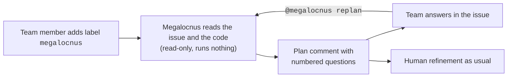

# Let a Claude bot ("Megalocnus") refine issues

## Context and Problem Statement

Many of our issues reach refinement half-specified, and the first part of every refinement is finding out what is unclear.
Several of us already use Claude Code locally for that kind of work.
This RFC proposes a four-week pilot where a Claude bot reads an issue and the code it touches, and posts a plan with clarifying questions *before* the team refines it.
The bot writes no code; whoever picks up the issue implements it as usual.

## How the pilot works

* **Trigger:** a team member with write access adds the `megalocnus` label or comments `@megalocnus replan`. Editing the issue does not trigger a new plan. During the pilot the bot does not comment on new issues by itself, so nobody gets notifications they did not ask for.
* **Output:** one comment per run, under 300 words or so, following our issue templates: understanding (with a proposed user story if a feature lacks one), numbered questions, acceptance criteria as checkboxes ending with "Tests verifying the changes are added", a proposed plan, size (small/medium/big; priority stays with the team), overlapping open issues, impact on other repositories, and whether the issue is ready, needs answers, or should be split. A replan posts "Plan v2", "Plan v3" and so on.
* **Feedback:** each plan asks for a 👍 or 👎 reaction, which is what we evaluate at the end of the pilot.
* **Transparency:** comments come from `megalocnus[bot]` and end with a footer naming the model and saying that nothing has been changed and a human decides.
* **Runs on** GitHub-hosted runners with the Claude Code CLI in restricted mode, where it can only read the checkout. The comment is posted afterwards by a separate step as `megalocnus[bot]`, using the App @viklund registered. The instructions are in `.github/megalocnus/refine.md` and follow the repository's `AGENTS.md`.

## Why plan-only first

* It is the part we can try safely. The bot can only read files and comment: it has no shell, runs no code and cannot push, so a crafted issue can at worst produce a misleading comment, which a human reads anyway.
* It needs one workflow and one prompt file, not the machinery that letting a bot write and test code in a public repository requires.
* It tells us cheaply whether the bot's understanding of our code is good enough before anyone discusses letting it write code.

A design for a second phase, where the bot also opens draft PRs after a human says go, exists and will be proposed separately if the pilot is useful.

## Cost and billing

The pilot would run on @jhagberg's Claude Team seat, which Anthropic documents for GitHub Actions. Whether one person's seat may back a bot the whole team uses is not confirmed, so we should check that before starting or use a Console API key instead. In local test runs a plan took about 30 seconds, which would cost around 0.30 USD at API prices.

## Rollout

1. `AGENTS.md` (#2662), so the bot and our local agents share the same repository conventions.
2. This RFC.
3. One workflow and one prompt file, tried locally on real issues and then tested here after merge, since issue workflows only run from `main`.
4. Four weeks; the sprint retrospective decides whether to continue, change or stop.

To stop the bot, disable the workflow in the Actions tab.

## Open Questions

* **Every new issue later?** The pilot only runs on labelled issues. If the plans are good, should the bot comment on every issue the team opens?
* **What should the plan contain?** Are the headings above right, and is anything missing that we always ask in refinement?
* **Billing after the pilot:** a Console API key with a spend cap, or another option, and who owns that budget?
* **Phase 2:** if the plans are good, do we want the bot to also open draft PRs?

## Considered Options

* **Plan-only pilot (proposed).**
* **Plan and implement in one pilot.** Rejected for now: safely running bot-written code with write access in a public repository needs several isolated jobs and a long list of safeguards, which is a lot to build before we know whether the plans are useful.
* **No bot; refine as today.** Costs nothing, but we learn nothing.

Where to run it: self-hosted runners are ruled out because GitHub [advises against them for public repositories](https://docs.github.com/en/actions/reference/security/secure-use), and Anthropic's cloud sessions cannot be triggered from issues and act as a person rather than a team bot.

## More Information

* [Claude Code GitHub Actions documentation](https://code.claude.com/docs/en/github-actions)
